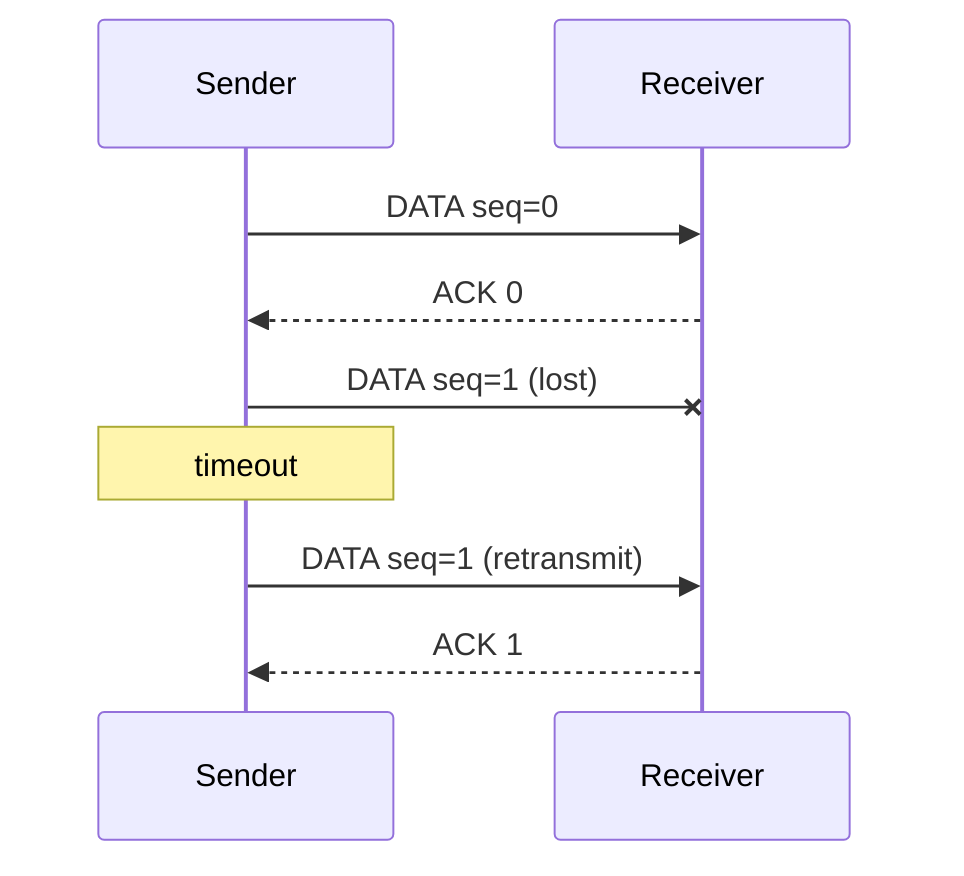
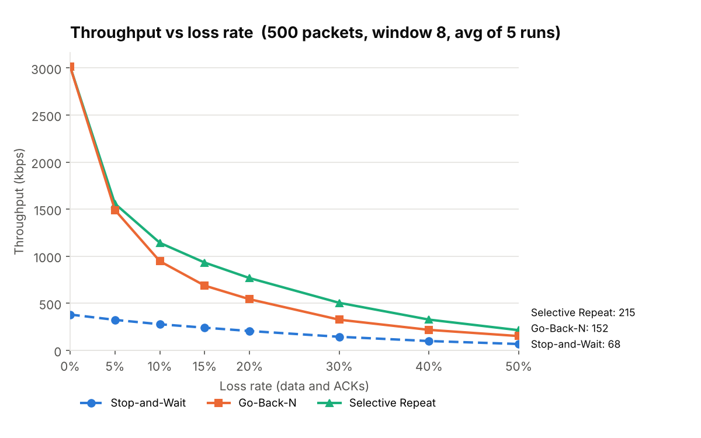
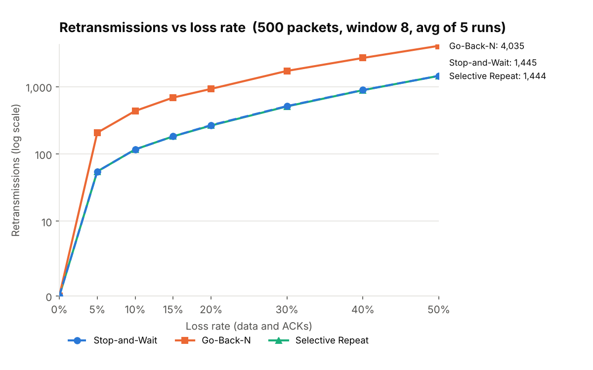
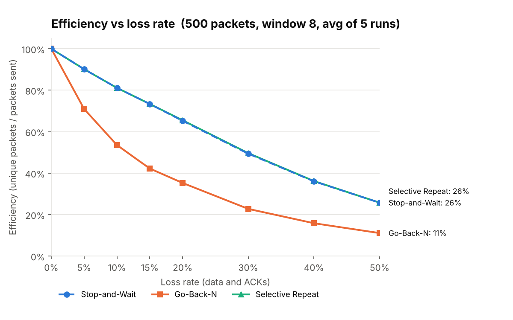
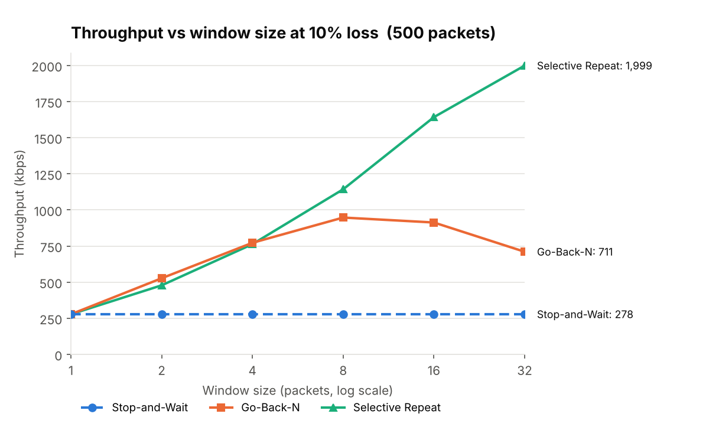

# ARQ Protocol Simulator

A discrete-event simulator for the three classic **Automatic Repeat reQuest (ARQ)** protocols — **Stop-and-Wait**, **Go-Back-N** and **Selective Repeat** — running over a fake network that loses, corrupts and delays packets on purpose.

It measures how each protocol copes, produces comparison charts, and is backed by 123 unit tests that check the one promise every ARQ protocol makes: *every packet arrives, exactly once, in order — no matter what the network does.*

```
python main.py --protocol gbn --packets 1000 --loss 0.1 --window 4
```

---

## Contents

- [What is ARQ?](#what-is-arq)
- [How each protocol works](#how-each-protocol-works)
- [How the simulator works](#how-the-simulator-works)
- [Getting started](#getting-started)
- [Example output](#example-output)
- [Results](#results)
- [Running the tests](#running-the-tests)
- [Project structure](#project-structure)

---

## What is ARQ?

Networks are unreliable. Packets get dropped by busy routers, damaged by noise, or delayed. **ARQ** is the family of techniques that turns an unreliable link into a reliable one using just three ideas:

1. **Checksums** – the sender attaches a checksum; the receiver recomputes it. If they don't match, the packet was damaged and is thrown away.
2. **Acknowledgements (ACKs)** – the receiver tells the sender "I got packet *k*".
3. **Timeouts and retransmission** – if the sender doesn't hear an ACK in time, it assumes the packet was lost and sends it again.

Add **sequence numbers** so the receiver can tell new packets from repeats, and you have reliable delivery. This is the core idea behind TCP.

The three protocols differ in **how many packets the sender may have "in flight" at once** and **what it resends when something goes wrong**.

## How each protocol works

### Stop-and-Wait

Send one packet. Wait for its ACK. Repeat.

- If the ACK doesn't arrive before the timer runs out, resend the same packet.
- A 1-bit sequence number (0, 1, 0, 1 …) is enough: it lets the receiver spot a repeat of a packet it already delivered (which happens when the *ACK* was lost, not the packet).
- **Weakness:** the link sits idle while the sender waits a full round trip. With a 1 ms transmit time and 10 ms delay each way, the link is busy only 1/21 ≈ **4.8%** of the time.



### Go-Back-N

Keep up to **N** packets in flight (the *window*) instead of one.

- **Cumulative ACKs:** ACK *k* means "I have everything up to and including *k*". One ACK can confirm many packets, so a lost ACK is often harmless.
- **The receiver has no buffer.** It only accepts the exact next packet it expects. Anything after a gap is discarded.
- **One timer**, for the oldest unacknowledged packet. On timeout the sender **goes back** and resends *everything* from that packet onward.
- **Rule:** with *k*-bit sequence numbers, the window must be ≤ 2<sup>k</sup> − 1.
- **Weakness:** one lost packet forces the whole window to be resent, even packets that arrived fine.

### Selective Repeat

Also keeps **N** packets in flight, but treats each one individually.

- **Individual ACKs:** ACK *k* confirms only packet *k*.
- **The receiver buffers** packets that arrive after a gap, then delivers them in order once the gap is filled.
- **One timer per packet.** On timeout, only that packet is resent.
- **Rule:** the window must be ≤ 2<sup>k−1</sup> (half the sequence space). Otherwise, after the sequence numbers wrap around, a retransmitted *old* packet would look identical to a *new* one.
- **Cost:** more state on both sides (a timer per packet, a receive buffer).

| | Stop-and-Wait | Go-Back-N | Selective Repeat |
|---|---|---|---|
| Packets in flight | 1 | up to N | up to N |
| ACK type | individual | cumulative | individual |
| Receiver buffer | none | none | N packets |
| Timers | 1 | 1 (oldest packet) | 1 per packet |
| On loss, resends | that packet | that packet **and all after it** | only that packet |
| Max window (k-bit seq) | 1 | 2<sup>k</sup> − 1 | 2<sup>k−1</sup> |

## How the simulator works

**Discrete-event simulation.** There are no threads and no `sleep()`. A priority queue holds future events (a packet arriving, a timer expiring) sorted by simulated time. The main loop pops the earliest event, jumps the clock to it, and runs it — which may schedule more events. A run representing 30 seconds of network time finishes in milliseconds, and with a fixed `--seed` it is **exactly repeatable**.

**The error-simulation engine** ([`arq/channel.py`](arq/channel.py)). For every packet the channel decides:

| Error | Setting | What happens |
|---|---|---|
| Data loss | `--loss` | The packet silently disappears. |
| ACK loss | `--ack-loss` | Same, for ACKs (defaults to the `--loss` value). |
| Corruption | `--corrupt` | One random bit is flipped. The packet still arrives, but its **CRC-32 checksum** no longer matches, so the receiver discards it. CRC-32 catches every single-bit error, so this is always detected. |
| Delay | `--delay`, `--jitter` | Each packet travels for `delay` ms plus a random `0..jitter` ms. |

**Timing model.** Each data packet takes `--tx-time` ms to put on the wire (one at a time), then `delay + jitter` ms to travel. The link is first-in-first-out: jitter can slow a packet down but never lets it overtake an earlier one. This is the same assumption the textbook window-size rules rely on.

**Timeouts.** By default the timeout is set to 1.5 × the worst-case round trip, plus time for a full window to be transmitted. You can override it with `--timeout`; setting it too low causes needless retransmissions (try it), but the tests confirm it never breaks correctness.

**Sequence numbers wrap around.** Packets carry `index mod 2^k` in their header, just like a real k-bit field. The default `k` is the smallest safe value for the window size, and illegal combinations are rejected:

```
$ python main.py --protocol sr --window 8 --seq-bits 3
error: Selective Repeat needs window <= 2^(seq_bits-1); window=8, 2^3=8. Use seq_bits >= 4.
```

### Metrics

| Metric | Meaning |
|---|---|
| **Throughput** | Useful (delivered) data per second of simulated time, in packets/s and kbps. |
| **Total packets sent** | Every data transmission, originals plus retransmissions. |
| **Retransmissions** | Transmissions of a packet that had already been sent at least once. |
| **Efficiency** | Unique packets ÷ total packets sent. 100% means nothing was ever sent twice. |
| **Link utilization** | Time spent transmitting *useful* data ÷ total time (the textbook "sender utilization"). |

## Getting started

Requires Python 3.9+.

```bash
git clone https://github.com/Iron-robot/arq-simulator.git
cd arq-simulator
pip install -r requirements.txt
```

### Run a single protocol

```bash
python main.py --protocol gbn --packets 1000 --loss 0.1 --window 4
python main.py --protocol sr  --packets 500  --loss 0.2 --corrupt 0.05 --jitter 5 --window 8
python main.py --protocol all --packets 1000 --loss 0.1 --window 8     # all three, side by side
python main.py --protocol sw  --packets 3    --loss 0.3 --seed 2 --verbose   # step-by-step trace
python main.py --protocol sr  --packets 200  --loss 0.1 --json          # machine-readable output
```

<details>
<summary><b>All options</b> (<code>python main.py --help</code>)</summary>

| Option | Default | Description |
|---|---|---|
| `--protocol`, `-p` | `gbn` | `sw`, `gbn`, `sr`, or `all` |
| `--packets`, `-n` | `1000` | Number of data packets to deliver |
| `--window`, `-w` | `4` | Sender window size (ignored by Stop-and-Wait) |
| `--seq-bits` | auto | Bits in the sequence-number field |
| `--loss` | `0.0` | Probability a data packet is lost |
| `--ack-loss` | = `--loss` | Probability an ACK is lost |
| `--corrupt` | `0.0` | Probability a packet has a bit flipped |
| `--delay` | `10.0` | One-way propagation delay (ms) |
| `--jitter` | `0.0` | Extra random delay, 0..jitter (ms) |
| `--timeout` | auto | Retransmission timeout (ms) |
| `--tx-time` | `1.0` | Time to transmit one data packet (ms) |
| `--packet-size` | `1000` | Bytes per packet (for kbps) |
| `--seed` | random | Random seed for a repeatable run |
| `--verbose`, `-v` | off | Print every send, loss, timeout and delivery |
| `--json` | off | Print results as JSON |

</details>

### Run the comparison

```bash
python compare.py                                  # 500 packets, window 8, 5 runs per point (~5 s)
python compare.py --packets 1000 --window 16 --seeds 10
```

Runs all three protocols at loss rates from 0% to 50% (applied to both data and ACKs), plus a window-size sweep, then saves four charts and a `results.csv` to `results/`.

## Example output

```
$ python main.py --protocol gbn --packets 1000 --loss 0.1 --window 4 --seed 42
Channel: loss=10%  ack-loss=10%  corrupt=0%  delay=10.0 ms  jitter=0.0 ms

-------------------------------------------------------------------------
Protocol                : Go-Back-N
Status                  : COMPLETED
Window size / seq bits  : 4 / 3 (seq numbers 0..7)
Timeout                 : 35.50 ms
Packets delivered       : 1000 / 1000
Total data packets sent : 1463
Retransmissions         : 463
Timeouts                : 116
ACKs sent               : 1317
Lost (data / ACK)       : 146 / 118
Corrupted (data / ACK)  : 0 / 0
Duplicates discarded    : 317
Simulated time          : 10,630.0 ms
Throughput              : 94.1 packets/s  (752.6 kbps)
Efficiency              : 68.4%  (unique packets / packets sent)
Link utilization        : 9.4%  (useful transmit time / total time)
-------------------------------------------------------------------------
```

With `--verbose` you can watch the protocol recover, event by event. Here the first ACK is lost, then the retransmission is lost too, and the receiver correctly recognises the third copy as a duplicate:

```
$ python main.py --protocol sw --packets 3 --loss 0.3 --seed 2 --verbose
[      0.00 ms] SENDER   send       DATA(seq=0) (packet #0)
[     11.00 ms] RECEIVER got        DATA(seq=0)
[     11.00 ms] RECEIVER deliver    packet-000000 to application
[     11.00 ms] RECEIVER send ACK(seq=0)
[     11.00 ms]   channel: ACK(seq=0) LOST
[     33.50 ms] SENDER   TIMEOUT waiting for ACK(seq=0)
[     33.50 ms] SENDER   retransmit DATA(seq=0) (packet #0)
[     33.50 ms]   channel: DATA(seq=0) LOST
[     67.00 ms] SENDER   TIMEOUT waiting for ACK(seq=0)
[     67.00 ms] SENDER   retransmit DATA(seq=0) (packet #0)
[     78.00 ms] RECEIVER got        DATA(seq=0)
[     78.00 ms] RECEIVER send ACK(seq=0)
[     88.00 ms] SENDER   got        ACK(seq=0)
[     88.00 ms] SENDER   send       DATA(seq=1) (packet #1)
...
[    130.00 ms] SENDER   all packets acknowledged - done
```

## Results

Generated by `python compare.py` (500 packets, window 8, 10 ms one-way delay, 1 ms transmit time, each point averaged over 5 seeded runs).

### Throughput vs loss rate



On a clean link, the windowed protocols are **~8× faster** than Stop-and-Wait (3,017 vs 381 kbps), because they keep 8 packets in flight instead of 1. As loss rises, Selective Repeat holds up best: at 10% loss it delivers 1,143 kbps against Go-Back-N's 947 kbps and Stop-and-Wait's 278 kbps.

### Retransmissions vs loss rate



Go-Back-N resends far more, because each loss triggers a resend of the whole window. Stop-and-Wait (dashed) and Selective Repeat lie **on top of each other**: both resend only the packet that was actually lost, so they waste the same number of transmissions — Selective Repeat just isn't idle while it waits.

### Efficiency vs loss rate



The same story as a percentage. At 10% loss, 81% of Selective Repeat's transmissions are useful versus 54% for Go-Back-N.

### Throughput vs window size



The most interesting chart. Selective Repeat keeps getting faster as the window grows. Go-Back-N **peaks at a window of 8, then gets slower**: a bigger window means more packets thrown away and resent after every loss. Stop-and-Wait is flat because its window is always 1. At very small windows Go-Back-N slightly edges out Selective Repeat, because its cumulative ACKs make a lost ACK harmless, whereas Selective Repeat must resend any packet whose individual ACK went missing.

### Sanity check against theory

The simulator's numbers match the textbook formulas:

| Quantity | Formula | Theory | Simulated |
|---|---|---|---|
| Stop-and-Wait utilization, no loss | t<sub>tx</sub> / (t<sub>tx</sub> + 2·delay) = 1/21 | 4.76% | 4.76% |
| Window-8 utilization, no loss | 8/21 | 38.1% | 37.7% (startup cost) |
| Sends needed for 500 packets, 10% loss each way (SW/SR) | 500 / (0.9 × 0.9) | 617 | 617 |

## Running the tests

```bash
pytest
```

123 tests, under 2 seconds. They cover:

- **Correctness under every kind of failure.** All three protocols × 7 channel types (perfect, data loss, ACK loss, corruption, jitter, everything combined, 50% loss) × 3 seeds: every packet is delivered, in order, with no duplicates.
- **Sequence-number wrap-around** at the tightest legal settings (Go-Back-N window 7 with 3 bits, Selective Repeat window 4 with 3 bits).
- **Premature timeouts** — a timeout far shorter than the round trip still delivers correctly.
- **Illegal settings rejected** — windows too large for the sequence space, loss rate of 100%, negative delay.
- **The channel itself** — observed loss and corruption rates match the settings, every corruption fails the checksum, jitter never reorders packets.
- **Behaviour** — no retransmissions on a clean link, Stop-and-Wait timing matches the formula, window 1 behaves like Stop-and-Wait, Selective Repeat retransmits less than Go-Back-N, identical seeds give identical results.
- **The CLI** — text output, JSON output, error messages, verbose trace.

## Project structure

```
arq-simulator/
├── main.py                       # command-line interface
├── compare.py                    # runs all protocols at many loss rates, saves charts
├── arq/
│   ├── config.py                 # SimConfig and ChannelConfig (all the settings)
│   ├── packet.py                 # Packet + CRC-32 checksum + bit-flip corruption
│   ├── events.py                 # discrete-event scheduler (priority queue of timed events)
│   ├── channel.py                # error-simulation engine: loss, corruption, delay
│   ├── metrics.py                # counters and derived metrics (throughput, efficiency…)
│   └── protocols/
│       ├── base.py               # shared plumbing: timers, sending, delivery, run loop
│       ├── stop_and_wait.py
│       ├── go_back_n.py
│       └── selective_repeat.py
├── tests/
│   ├── test_protocols.py         # correctness of all three protocols
│   ├── test_channel.py           # packets, checksums, scheduler, channel
│   └── test_cli.py
└── results/                      # charts and CSV from compare.py
```

Each protocol class only implements what is unique to it — how the sender handles ACKs and timeouts, how the receiver handles data, and which window sizes are legal. Everything else lives in the shared base class.

## Possible extensions

- Adaptive timeouts (estimate RTT like TCP's Jacobson/Karels algorithm)
- Negative acknowledgements (NAKs) for faster recovery
- Bursty loss (Gilbert–Elliott channel model) instead of independent random loss
- Piggybacked ACKs for two-way traffic
